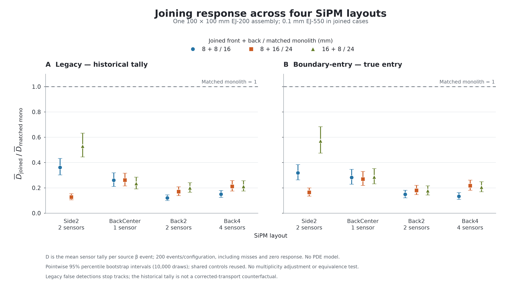

# Issue #7：单样品、四种 SiPM 布局与两种读出定义

日期：2026-10-12（America/New_York）。

**实现及固定 8,000-beta Docker 比较已完成。四种布局、两种读出中，三个拼接方案的平均收集量均低于各自对应整块。换到背面没有消除下降。** 本轮是单样品和原 beta 谱；不包含十层钢板或中子扫描。

分支 `codex/combined-tiles-study`，基于 `404a11bcff4a2c3a4b7a83de8357cab3e37d1cb5`。2026-10-16 将实现、工具、研究记录及小型结果资产作为阶段性检查点归档；原始运行证据继续保存在本地，未纳入 Git。当前停止追加研究，后续仅在用户明确要求继续 Issue #7 时推进。

## 研究条件与几何

4 种布局 × 5 种几何 × 2 种读出 = **40 配置**。每配置两个独立 100-event seed block，总计 80 个进程、8,000 个源 beta 事件。预算在正式运行前固定；没有按结果补样、重跑或筛选事件。

- EJ-200 横向 100×100 mm；整块 16/24 mm，对比 8+0.1+8、8+0.1+16、16+0.1+8 mm。顺序沿源方向 +Z → −Z。
- 中间 0.1 mm EJ-550，n=1.46；两片塑料厚度完整保留，总外包厚度为 16.1/24.1 mm。
- 原 `sr90_allowed_beta_v1` beta 谱；中央点源沿 −Z，位于实际 +Z 入口面外 1.5 mm；裸抛光面。
- SiPM 单颗 2.4×2.4×0.5 mm；没有 PDE、fill factor 或电子学模型；关闭钢板、重复 stack、dimple 和旧的 SiPM 耦合脂选项。

以 H=完整外包厚度/2 表示：

| 布局 | 数量 / 总接收面面积 | 传感器中心坐标 mm |
|---|---:|---|
| Side 2 | 2 / 11.52 mm² | (50.25, −25, 0)、(50.25, +25, 0)，同一 +X 面 |
| Back Center | 1 / 5.76 mm² | (0, 0, −H−0.25) |
| Back 2 | 2 / 11.52 mm² | (−25, −25, −H−0.25)、(+25, +25, −H−0.25) |
| Back 4 | 4 / 23.04 mm² | 四个 (±25, ±25, −H−0.25) |

Back 的坐标已改为完整外包厚度，避免旧塑料厚度公式造成的 **0.05 mm 重叠**。每个 Back SiPM 完整贴合后片外表面，实体向 World 延伸。单样品无需十层模型中用于容纳 SiPM 的模块间空隙；这里没有新增空气夹层，片间仍只有 0.1 mm EJ-550。

Side 2 在 8+8 时跨缝，每颗接触前片/胶/后片面积为 2.76/0.24/2.76 mm²；非对称拼接时全部贴合 16 mm 片。因此 8+16 时 Side 2 位于后片，16+8 时位于前片；Back 始终位于后片。这是物理接触条件的一部分。

## 双读出的实现与含义

新的 `/opnovice2/combined/layoutStudy true` 是显式 opt-in，支持一个完整样品的 1/2/4 路传感器。默认 false 保留原路径；原 scan 列编号不变，新增第 3/4 路谱系和边界观察列。

- **legacy**：完整保留历史 `prePV == SiPM` 计数并终止光子的路径。它可能把反射后 StepTooSmall 回迁当成检测。
- **boundary-entry**：实际几何边界进入不同 SiPM post-volume，且状态为 Transmission/FresnelRefraction/SameMaterial 时才计数并终止。其 D 表示理想 SiPM 体积成功入射的光子数。

两种模式在本研究中都额外记录真实入射、反射和候选 StepTooSmall，四路分别检查。旧模式中的 D−真实入射数，是该历史轨迹内的误计诊断；**不能把它直接减掉后当作 corrected 模式的反事实结果**，因为错误终止已经改变后续传播和随机数消耗。两模式独立重跑、使用不同种子，不进行事件配对或混合。

## 结果：每个源 beta 的平均 D

每格均基于 200 个发射的源 beta，包含未入块和零响应事件。8,000 个事件中 `hit_valid` 共 7,916，未记录 primary 入块的 84 个事件仍留在分母。legacy 的 D 是历史计数；boundary-entry 的 D 是真实入射计数，二者不能混称为 photoelectrons。

| 读出 | 布局 | 整块 16 | 整块 24 | 8+胶+8 | 8+胶+16 | 16+胶+8 |
|---|---|---:|---:|---:|---:|---:|
| legacy | Side 2 | 133.325 | 101.700 | 48.160 | 12.965 | 53.875 |
| legacy | Back Center | 73.480 | 44.845 | 19.120 | 11.725 | 10.525 |
| legacy | Back 2 | 118.190 | 87.745 | 14.180 | 14.950 | 17.545 |
| legacy | Back 4 | 218.315 | 148.665 | 32.745 | 31.470 | 31.470 |
| boundary-entry | Side 2 | 107.970 | 67.550 | 34.310 | 11.090 | 38.530 |
| boundary-entry | Back Center | 56.175 | 35.040 | 15.815 | 9.430 | 10.030 |
| boundary-entry | Back 2 | 81.995 | 64.945 | 12.190 | 11.685 | 11.515 |
| boundary-entry | Back 4 | 186.870 | 128.180 | 24.955 | 27.835 | 26.330 |

## 拼接相对整块的变化

下表是 `100×(D拼接/D对应整块−1)`，单位 %，方括号为 pointwise 95% bootstrap 区间。8+8 对比整块 16；两个非对称方案均对比同一布局、同一读出的整块 24。

| 读出 | 布局 | 8+胶+8 / 整块 16 | 8+胶+16 / 整块 24 | 16+胶+8 / 整块 24 |
|---|---|---:|---:|---:|
| legacy | Side 2 | -63.9 [-69.7, -56.8] | -87.3 [-89.5, -84.7] | -47.0 [-55.6, -36.7] |
| legacy | Back Center | -74.0 [-78.8, -68.1] | -73.9 [-78.5, -68.4] | -76.5 [-80.8, -71.5] |
| legacy | Back 2 | -88.0 [-90.1, -85.5] | -83.0 [-86.1, -79.2] | -80.0 [-83.5, -75.9] |
| legacy | Back 4 | -85.0 [-87.5, -82.1] | -78.8 [-82.5, -74.3] | -78.8 [-82.4, -74.3] |
| boundary-entry | Side 2 | -68.2 [-73.7, -61.6] | -83.6 [-86.5, -80.1] | -43.0 [-52.5, -31.7] |
| boundary-entry | Back Center | -71.8 [-77.1, -65.3] | -73.1 [-78.0, -67.0] | -71.4 [-76.8, -64.8] |
| boundary-entry | Back 2 | -85.1 [-87.9, -81.9] | -82.0 [-85.3, -78.0] | -82.3 [-85.6, -78.4] |
| boundary-entry | Back 4 | -86.6 [-89.0, -83.8] | -78.3 [-81.9, -73.8] | -79.5 [-83.0, -75.1] |

该图显示拼接/对应整块的比值，1 表示相同平均响应；两面板分别是旧/新读出。所有 24 个拼接对照的点状区间均低于 0% 变化，但这不是经过多重校正的联合置信声明，也不是实验等效性检验。

**下降并非 Side 2 特有。** corrected 模式下 Back Center 下降约 71–73%，Back 2 约 82–85%，Back 4 约 78–87%。Back 4 增加接收面积后，仍未恢复本布局整块样品的收集量。跨布局的绝对 D 同时受到数量、面积与位置影响；Back 2 与 Side 2 数量/面积一致，更适合检验位置差异。

在 corrected 模式中，Back 2 相对 Side 2 的“拼接保留比例之比”Q：

| 拼接方案 | Q = (Back 2 拼接/整块)/(Side 2 拼接/整块) [95% CI] |
|---|---:|
| joined8-8 | 0.468 [0.356, 0.616] |
| joined8-16 | 1.096 [0.831, 1.454] |
| joined16-8 | 0.311 [0.236, 0.408] |

8+8 与 16+8 中，Back 2 的相对保留比例更低；8+16 未显示清晰改善。其余全部 18 个 Q 对照保存在 `analysis/interactions.csv`，不挑选区间来宣称某布局普遍优越。

## 朝向效应与旧计数偏差

下面比较同一布局的 `(16+胶+8)/(8+胶+16)`；两个朝向具有相同塑料总厚度与源面距离。

| 读出 | 布局 | 朝向响应比 [95% CI] |
|---|---|---:|
| legacy | Side 2 | 4.155 [3.443, 5.026] |
| legacy | Back Center | 0.898 [0.734, 1.098] |
| legacy | Back 2 | 1.174 [0.950, 1.452] |
| legacy | Back 4 | 1.000 [0.827, 1.215] |
| boundary-entry | Side 2 | 3.474 [2.869, 4.207] |
| boundary-entry | Back Center | 1.064 [0.865, 1.308] |
| boundary-entry | Back 2 | 0.985 [0.791, 1.217] |
| boundary-entry | Back 4 | 0.946 [0.783, 1.147] |

Side 2 的朝向差异在两种读出下都明显：旧模式约 4.16 倍，新模式约 3.47 倍；背面三种布局的区间均包含 1。后者表示目前样本没有分辨出明确朝向差异，不能推出两个朝向等效。

旧模式每个配置中，约 **19.6–22.4% 的历史 D 没有对应同一历史轨迹中的真实入射**。新模式的 D 与真实入射逐事件逐传感器相等，超额为零。完整 20 个新/旧模式响应对照另存 `analysis/comparisons.csv` 的 `readout-definition` 行；它们包含独立源谱抽样和不同终止逻辑的影响，不能解释为纯粹的统一校正系数。

这些结果与“光在接缝两侧的传输和传感器接触哪一片共同决定响应”一致。Back 的存在未救回响应，而 Side 2 贴合源侧 16 mm 片时保留更多光；但是这里没有单独改变胶吸收、折射率或界面，因此仍不能给胶层吸收、界面反射、读出位置分配独立损失百分比。

## 工程验证和统计边界

| 检查 | 本轮结果 |
|---|---|
| 工具测试 | 32 项通过 |
| 几何 | 40 配置、零事件检查全部通过；实际 bounds/contact 日志与正体积重叠检查一致 |
| beta 初检 | 40×5=200 事件通过，四路/两模式按相应语义记账 |
| Side 2 回归 | 20×10=200 事件通过；覆盖旧 flag 省略及启用两变体、五几何、两读出；原数据列、汇总、直方图和最终 RNG 与 v2 参考一致 |
| 定向 optical probes | 22×50=1,100 事件通过；包含两模式全部传感器及 Side 2 接缝入射，Back 4 第 3/4 路均非零且记账正确 |
| 正式比较 | 80×100=8,000 beta，全部正常退出，完整保留；无失败/替补批次，无 NoRINDEX 记录 |
| 独立复核 | C++ 计数路径与统计方法只读检查；原始 ROOT/CSV、40 均值、52 直接对照和 18 个 Q 及保存的联合 bootstrap 区间复核，详见 analysis 下 review 文件 |

工程事件不进入正式样本。正式事件在每个 seed block 内整事件重采样 10,000 次，固定 bootstrap seed 12102026；40 配置的联合均值矩阵只生成一次，同一 mono24 对照在相关对照中使用同一列。区间为点状 percentile 95%，没有多重性校正、等效阈值或实验系统误差项。

200 事件/配置的 beta 谱抽样仍有可见波动，配置平均初始能量为 0.487–0.663 MeV；所有配置使用同一冻结谱但不同种子。没有事后按能量配对、筛选或改变主指标。

物理解释还受以下固定模型限制：

- EJ-550 采用 `L=−0.1 mm/ln(T)` 的既有样片透射推导有效衰减长度，未分离纯体吸收、反射和散射。结果不能视作已标定的实验损失预测。
- Legacy G 不包含全部 optical-parent births，不能将 D/G 当完整光收集效率；tile edep 包含光学沉积。拼接诊断单独记录 optical/nonoptical 分量。
- 边界表记录重复相遇和候选相邻体积，并非独立透射概率；未实现全部光子的终态/全路径闭合，不能据此拆分因果损失份额。
- 非 stack 研究的第 3/4 路在内部继承的旧 stack-local 槽仍使用 stride 2；本研究不输出该 stack 表，按全局 copy 0–3 读取 scan、readout 和 combined transfer，当前分析不使用那些旧槽。
- 几何同时有实际 AABB/contact 检查和 Geant4 抽样 overlap 检查；不将后者声称为所有边界轨迹的数学证明。

## 可复现材料

证据根目录：`outputs/combined-layouts/20261012-dual-readout-v1/`。原始 ROOT 与逐任务日志为 Git 忽略的本地材料。旧 v1、旧 v2、PR #6 的数据均未混入；旧 v2 仅作工程回归参考。

- `explore/manifest.json`：40 配置、80 任务、固定预算、源/材料/代码/工具 hash、独立种子。
- `explore/*/*/*/block-*`：各任务宏、ROOT、汇总、日志、RNG、真实退出凭据。
- `qualification.json` 及 geometry/smoke/regression/probes 的 audit：真实证据重新审计后放行正式运行。
- `analysis/analysis.json`、`summary.csv`、`comparisons.csv`、`interactions.csv`：完整数值；`bootstrap_means.npz` 为 10,000×40 联合均值；其他 CSV 保留全部逐事件诊断。
- `analysis/joining-response.png` 和 `.pdf`：同尺度双读出对比图；`plot_joining.py` 为绘图源。
- `runtime/`、`build-inputs.json`：实际冻结构建输入；`reproduction/`、`reproduction-manifest.json`、`implementation.patch` 为最终源码与文档备份。
- `image.json`、`container.json`、`container-final.json`、`data-receipt.json`、`runtime-environment.json`：环境与容器凭据。

容器 `g4-combined-layouts-20261012-v1`；Geant4 11.4.2、linux/arm64、Serial；Python 3.10.12、NumPy 2.0.2、uproot 5.6.9。非 root、无网络，源码及 Geant4 数据只读，输出独立；2 CPU/4 GiB 限额，最多两个独立进程并行。正式进程耗时之和 1,230.82 秒，不等同于墙钟时间。沿用已验证安装收据，本轮没有对整个解压数据集重新逐文件计算 hash。

- image SHA256：`316f3970072d236f994a98f05b9702f7888c577c0b1971ce6e826689220b71ee`
- executable SHA256：`d56372364aa9288a9a867dfbac768274bbcfcc804344751458e16a7b60c397e7`
- explore manifest SHA256：`66d8b2e4d479f3ac80f115d1c0f97820ea586320fd11a8ff199f90425676b68c`
- analysis.json SHA256：`35fe55bb110d8cdafe85a3ff61c7d24f47afc0a249aab3289333cc67eb117feb`

复现命令与各表定义见 [工具 README](../../tools/combined_layouts/README.md)。前一轮 Side 2 结果见 [旧 v2 记录](combined-tiles-study.md)。上游问题：[Issue #7](https://github.com/jdbrice/g4optics/issues/7)；四布局坐标参考：[PR #6](https://github.com/jdbrice/g4optics/pull/6)，其十层钢板/中子结果不作本轮物理对照。

## 阶段归档与后续接续（2026-10-16）

已完成的实现、固定 8,000-beta 比较及现有数据机制诊断都在本分支保留。结果已发布并读回核对：

- [四布局、双读出结果](https://github.com/jdbrice/g4optics/issues/7#issuecomment-6131260575)。
- [第二轮现有光子诊断](https://github.com/jdbrice/g4optics/issues/7#issuecomment-6131563909)。

已有诊断使用 corrected 的 12 个拼接配置、2,400 个源事件，没有追加模拟。胶层无光子出生，在全部成功跨界中用入口次数减去出口次数推得胶内终止数，再与光学能量及已启用物理过程核对。该局部平衡支持胶内体吸收归属；不等于保存了逐轨迹终态标签，也不能套用于有 false kill 的 legacy 轨迹。

| 布局 | 8+胶+8 | 8+胶+16 | 16+胶+8 |
|---|---:|---:|---:|
| Side 2 | 24.08% | 22.00% | 22.15% |
| Back Center | 24.16% | 22.11% | 22.10% |
| Back 2 | 24.06% | 22.00% | 22.08% |
| Back 4 | 23.82% | 21.79% | 21.84% |

上表分母为全部记录的光子出生数（含 optical-parent 二次出生），不是整块收光量。前塑料→胶的有效边界相遇中，TIR 约占 35%–54%，普通 Fresnel 反射约 0.9%–1.2%；这些是重复相遇频次，不是不同光子的损失率。Side 2 两个非对称朝向的胶吸收比例近似相同，但 D 相差约 3.47 倍。证据支持胶层吸收与受全反射限制的跨层传播共同作用，不能唯一分配它们对收光下降的因果贡献。

后续讨论过的产光检查、胶专属透明极限 × 折射率匹配四格对照，以及外表面 painting，**均未实现或运行**；没有在本次归档中启动这些工作。EJ-550 吸收模型仍由样片总透射率拟合，纯体吸收与接口/散射损失未独立标定。

Git 中仅保存以下小型结果资产，来自通过审计的本地输出；图逐字复制，CSV 仅将 CRLF 换行统一为 LF，字段和数值不变：

- [40 配置汇总](assets/combined-layouts-20261012/summary.csv)、[52 项直接比较](assets/combined-layouts-20261012/comparisons.csv)、[18 项布局交互比较](assets/combined-layouts-20261012/interactions.csv)。
- [机制诊断数值](assets/combined-layouts-20261012/mechanism-summary.csv)、上文 PNG 及 [PDF 图](assets/combined-layouts-20261012/joining-response.pdf)。
- [资产来源与 SHA256](assets/combined-layouts-20261012/provenance.json)。CSV 数值与原 JSON 行逐项一致，图的哈希与最终验证凭据一致。

完整 ROOT、宏、逐事件表、日志、RNG、bootstrap 矩阵、构建产物及机制诊断脚本仍在被忽略的 `outputs/`。机制证据根目录为 `outputs/combined-layouts/20261012-existing-diagnostics-v1/`。这些小型资产不是完整原始数据包；新克隆若要重跑旧结果回归及完整 qualification，需要另行取得原 v2 参考证据包。

归档前重新执行两套工具测试：`combined_tiles` 34 项、`combined_layouts` 32 项，合计 66 项通过。此次未重新运行 Geant4；C++ 及科学工具源文件仍与已通过 Docker 验证的冻结 manifest 一致。历史 manifest 的 `working_head` 保留真实运行时的 `404a11bc`，不会改写为后来的归档提交。
