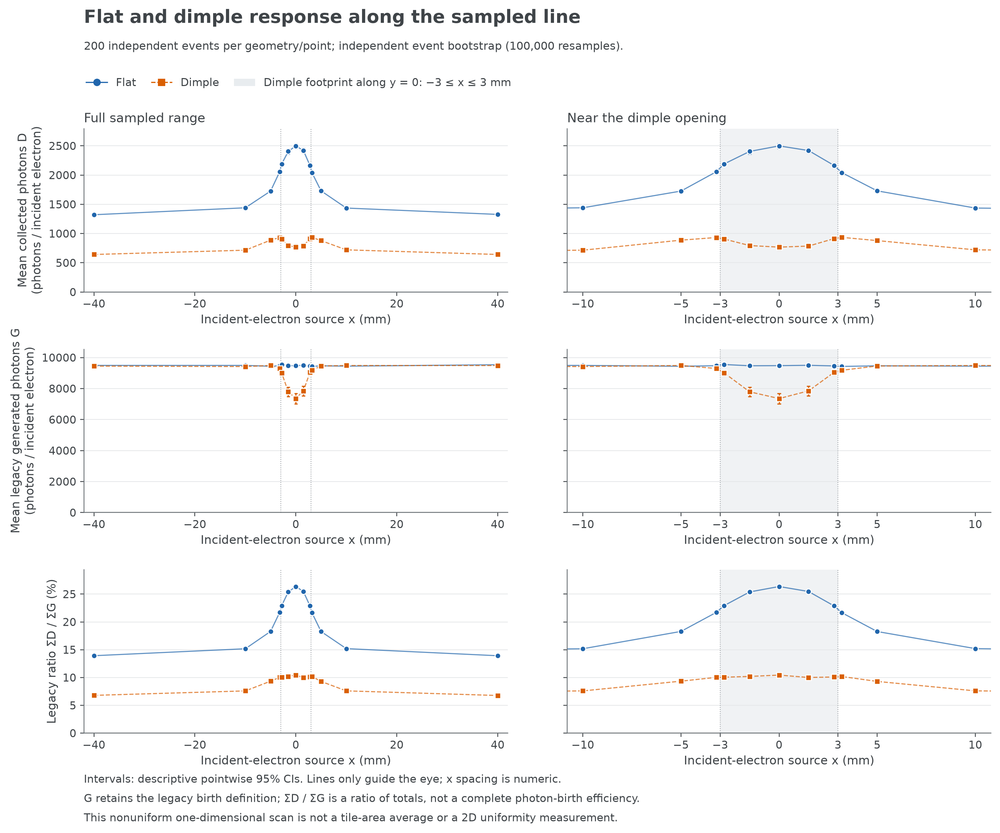
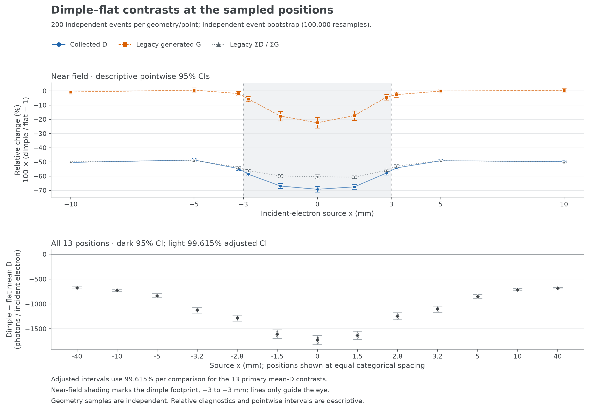
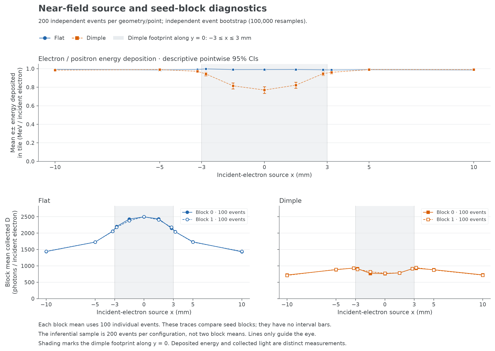

# 局部线扫分析：6×6 mm 外置 SiPM

[English results](README.en.md) · [从干净环境复现](../../REPRODUCE.md)

2026-10-08，固定模型下的探索性结果。

**在 y=0 线的全部 13 个采样位置，dimple 的平均收光都低于 flat，点估计降幅为
48.62%–69.28%。** 每种几何、每个位置包含两组独立种子的 100 个入射电子，
共 200 个事件；全部 52 个任务、5,200 个事件均纳入分析。

模型为 100×100×5 mm 单片、半径和深度 3 mm 的底部半球凹口、6×6×0.5 mm
外置 SiPM，接收面在 z=−2.5 mm。表面 bare polished，空气凹口，无光学胶；
World 的光学吸收长度仍是既有模型的 100 mm。光源为 (x,0,4) mm 的 1 MeV
单电子，沿 −Z。结果不代表任意 dimple、涂漆样品、全 tile 均匀性或真实 SiPM
的 PDE／电子学响应。

## 响应曲线



上排是每电子平均收光 D，中排是平均 legacy 产光 G，下排是总量之比 ΣD/ΣG。
右侧放大凹口附近；阴影为 |x|≤3 mm。横坐标保持真实、不均匀的点间距，连线
仅辅助看图，不能当作未采样区域的拟合响应。

## 中心 x=0

方括号为描述性逐点 95% bootstrap 区间；相对变化定义为 dimple/flat−1。

| 量 | Flat | Dimple | 相对变化及 95% 区间 |
|---|---:|---:|---:|
| 平均 D，光子/电子 | 2499.2 [2455.5, 2540.5] | 767.8 [721.7, 814.4] | −69.28% [−71.20%, −67.33%] |
| 平均 legacy G，光子/电子 | 9478.3 [9372.9, 9551.5] | 7355.2 [7006.2, 7696.0] | −22.40% [−26.15%, −18.72%] |
| Legacy ΣD/ΣG | 26.37% [26.03%, 26.71%] | 10.44% [10.12%, 10.79%] | −60.41% [−61.72%, −58.99%] |
| 平均 e± 沉积能量，MeV/电子 | 0.99059 [0.97955, 0.99806] | 0.76969 [0.73260, 0.80589] | −22.30% [−26.11%, −18.57%] |

中心平均 D 的绝对差为 **−1731.38 光子/电子**。针对 13 个平均-D 对照作
Bonferroni 调整后的个别 99.6153846% 区间为 **[−1822.10, −1636.53]**。
全部 13 个调整区间都低于零。调整目标为 nominal family-wise 95%；bootstrap
覆盖率是近似的，分析方案是在扫描及点估计之后确定的，不能当作预注册的确认性
检验。相对值及其他辅助指标只有描述性逐点 95% 区间。



## 如何解释

1. **在当前已覆盖整个圆口的 6×6 mm 方案中，dimple 仍有明显收光损失。**
   覆盖开口没有使这 13 个点的总收光恢复到 flat 水平。但本轮没有同口径的
   2×2 mm 外置光学曲线，不能量化扩大 SiPM 的改善，也不能说扩大没有用。
2. **中心产光减少伴随 e± 能量沉积减少。** 凹口中心沿未偏折入射直线的材料
   厚度是 2 mm，flat 为 5 mm，与观测方向相符；这不是电子实际散射轨迹长度，
   不能仅由厚度比例推导产光降幅。e± 沉积包括次级电子／正电子，不仅是初级电子。
3. **产光减少解释不了全部收光差异。** 中心产光比约 0.776，legacy 收集比之比
   约 0.396，两者乘积为收光比约 0.307。这是算术分解，不是两个独立的因果贡献。
   在 x=+40 mm，G 点估计仅低 0.54%，而 D 低 51.62%，也说明不能仅看产光总量。
4. **具体光学损失机制尚未被识别。** 中心事件的 legacy 闪烁出生重心平均 z
   从约 0.761 变为 0.992 mm；D/G 比较包含不同发光位置分布的影响。曲面折射／
   全反射、空气路径、吸收或逃逸都是候选解释。当前没有完整光程、边界历史或
   终态分类，不能把其中任何一项说成已经证实的原因。

G 保留 legacy 口径，不包含光学父粒子新产生的闪烁光子。后者在各格全部出生数
中约占 0.47%–0.54%；完整表也保存以全部出生数为分母的 entry-per-birth 比值。
它不改变平均 D 本身，也不是 PDE 或完整光子命运账本。

## 稳定性与核验



- 两块平均 D 的相对差最大为 6.25%（dimple、x=−1.5 mm）；26 个 block 差值的
  描述性 95% 区间均包含零。12 个左右对称差值区间也均包含零。这表示未发现超出
  此样本统计波动的差异，不是等价、精度达标或充分稳定性的证明。
- 全部事件保留；本批没有 D=0 或 G=0 事件。各格最高 1% 事件对总 D 的贡献
  不超过 2.59%，没有少数极端事件主导均值的迹象。
- 每格 100,000 次整事件 bootstrap，固定分析种子 2026100801；D、G、出生数和
  能量共用事件权重，两种几何独立重采样。统计样本是 200 个电子，不是两个块均值。
- 独立核验器直接读取 52 个原始 ROOT 和保存的重采样数组，没有导入生产分析器、
  重新 bootstrap 或运行模拟。**22,323 项检查通过**，最大数值差 1.82×10⁻¹²。
  详见[独立核验记录](independent-validation.json)。三张最终 PNG 已逐张检查，
  SVG 结构有效；图表和数值使用同一份结果 JSON。

## 数据与复现

- [全部数值与区间](result.json)、[逐格表](configuration-summary.csv)、
  [13 个对照](contrasts.csv)、[5,200 个逐事件提取记录](events.csv)。
- [扫描清单](campaign-manifest.json)、[原始输入哈希](input-inventory.json)、
  [图文件清单](plot-manifest.json)；PNG 均有同名 SVG。
- 模拟源 `5d6c50d3`；扫描工具 `192b9a09`。
- 原始 ROOT、宏、日志、RNG 与回执已包含在 [2.8 MB 原始归档](raw-campaign.tar.gz)，
  [归档哈希与范围](raw-campaign-archive.json)可用于核对；本地原件仍在 `outputs/dimple-study/line-v1/`。
  重采样数组在 `outputs/dimple-study/line-analysis-v1/bootstrap.npz`，不重复纳入 Git；
  SHA256 为 `6a7e52aa6709e557578c7664b9021276ecbaf41b3c00dbee97e2ed0fac2de4de`。
- 方法与边界见 [ANALYSIS.md](../../ANALYSIS.md)。

重画图不需要 ROOT 或重新抽样：

```sh
python tools/dimple_study/plot_line.py \
  --result tools/dimple_study/results/line-v1/result.json \
  --output outputs/dimple-study/replayed-line-figures
```

若继续回答“大 SiPM 带来多少改善”，应补同口径的 2×2 mm 外置对照。
若解释“光子具体损失在哪里”，应增加能区分光程、界面及终态的针对性诊断。
本轮不启动这些新模拟。
